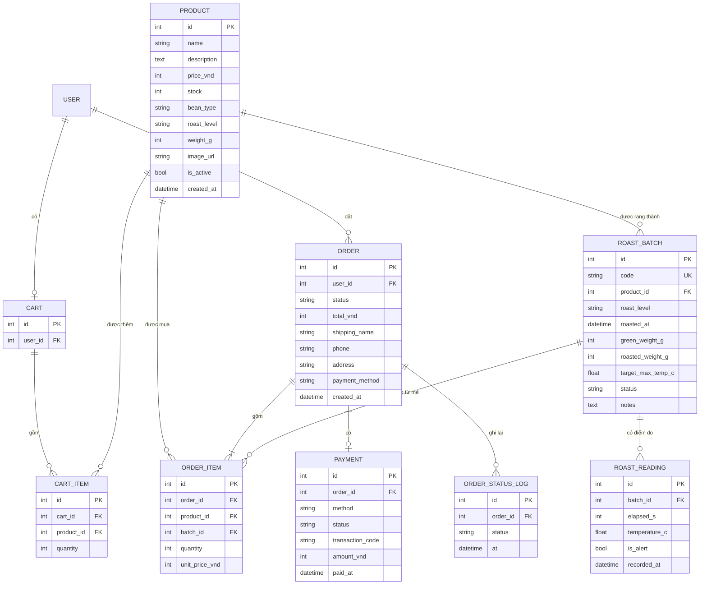

# Hợp đồng API, sơ đồ CSDL và lịch làm việc (bản nháp 1)

Trạng thái: nháp để nhóm cùng xem, chỉnh và chốt. Cập nhật 20/10/2026.

Hợp đồng API là "thỏa thuận" giữa backend và frontend: endpoint nào, gửi gì, nhận gì, lỗi ra sao. Chốt nó trước thì mỗi người làm song song mà không chờ nhau. Khi cần đổi, **báo cả nhóm và sửa file này trước**, rồi mới sửa code.

Quy ước chung:
- Địa chỉ gốc: `http://127.0.0.1:8000/api/`. Dữ liệu vào và ra đều là JSON.
- Tiền tính bằng đồng (số nguyên), tên trường `*_vnd`. Thời gian theo chuẩn ISO 8601.
- Đăng nhập: header `Authorization: Token <token>`. Ký hiệu quyền: **Public** (ai cũng gọi được), **Khách** (cần đăng nhập), **Admin** (cần tài khoản `is_staff`).
- Lỗi: DRF trả `{"detail": "..."}` hoặc `{"tên_trường": ["thông báo"]}`. Mã: 400 dữ liệu sai, 401 chưa đăng nhập, 403 không đủ quyền, 404 không có.
- Đường dẫn quản trị đặt dưới `/admin/...`, KHÔNG dùng trang admin có sẵn của Django.
- Backend kiểm tra mọi thứ (giá, tồn kho, quyền). Frontend không tự tính tiền hay tự quyết trạng thái.

---

## 1. Sơ đồ CSDL



Giá trị cố định (nên khai báo bằng `choices` trong model):
- `roast_level`: `light`, `medium`, `dark`.
- `ROAST_BATCH.status`: `roasting` (đang rang), `finished` (xong).
- `ORDER.status`: `pending` (chờ xác nhận) → `confirmed` (đã xác nhận) → `shipping` (đang giao) → `delivered` (đã giao); có thể `cancelled` khi còn `pending`.
- `PAYMENT.status`: `unpaid`, `paid`, `failed`. `payment_method`: `cod` (thanh toán khi nhận), `qr_mock` (quét mã giả lập).

Ghi chú thiết kế (dùng được trong báo cáo):
- `ORDER_ITEM.unit_price_vnd` lưu giá tại lúc mua, vì giá sản phẩm có thể đổi sau này.
- Sản phẩm không bị xóa hẳn, chỉ ẩn bằng `is_active = false`, vì đơn hàng cũ vẫn tham chiếu nó.
- `ORDER_ITEM.batch`: khi đặt hàng, hệ thống gán mẻ rang mới nhất còn đang bán của sản phẩm đó. Nhờ vậy khách xem được mẻ rang của chính túi cà phê mình mua.
- "Độ tươi" không lưu trong CSDL mà tính từ `roasted_at` đến hôm nay.

---

## 2. Danh sách API theo module

### Module D: tài khoản (`accounts`)

| Phương thức | Đường dẫn | Quyền | Mô tả |
|---|---|---|---|
| POST | `/auth/register/` | Public | Đăng ký khách. Body `{"username","password","email"}` → 201 `{"id","username"}` |
| POST | `/auth/login/` | Public | **Đã có.** Body `{"username","password"}` → `{"token"}` |
| GET | `/auth/me/` | Khách | Trả `{"id","username","is_staff"}` để frontend biết đang là ai |

### Module A: danh mục (`catalog`)

Đã có: `GET /products/` (tham số `q`, `roast_level`), `GET /products/<id>/`, và nhóm `/admin/products/` (thêm, sửa, ẩn).

Cần bổ sung:

| Phương thức | Đường dẫn | Quyền | Mô tả |
|---|---|---|---|
| GET | `/products/` | Public | Thêm tham số `bean_type`, `price_min`, `price_max`, `ordering` (`price_vnd`, `-price_vnd`, `-created_at`) |
| GET | `/products/<id>/` | Public | Thêm trường `latest_batch`: `{"code","roasted_at","freshness_days"}` hoặc `null` (lấy từ module C) |

### Module B: giỏ hàng, đơn hàng, thanh toán (`orders`, `payments`)

| Phương thức | Đường dẫn | Quyền | Mô tả |
|---|---|---|---|
| GET | `/cart/` | Khách | Xem giỏ |
| POST | `/cart/items/` | Khách | Thêm vào giỏ. Body `{"product_id","quantity"}`. Backend kiểm tra: sản phẩm còn bán, `quantity` ≥ 1, không vượt `stock`. Nếu đã có trong giỏ thì cộng dồn |
| PATCH | `/cart/items/<id>/` | Khách | Đổi số lượng. Body `{"quantity"}` |
| DELETE | `/cart/items/<id>/` | Khách | Bỏ khỏi giỏ → 204 |
| POST | `/orders/` | Khách | **Đặt hàng từ giỏ** (xem bên dưới) |
| GET | `/orders/` | Khách | Danh sách đơn của chính mình |
| GET | `/orders/<id>/` | Khách | Chi tiết đơn, gồm lịch sử trạng thái. Chỉ xem được đơn của mình |
| POST | `/orders/<id>/cancel/` | Khách | Hủy đơn, chỉ khi `status = pending` |
| POST | `/orders/<id>/pay/` | Khách | Thanh toán giả lập → `payment.status = paid`, sinh `transaction_code` |
| GET | `/admin/orders/` | Admin | Mọi đơn, lọc theo `?status=` |
| GET | `/admin/orders/<id>/` | Admin | Chi tiết một đơn |
| PATCH | `/admin/orders/<id>/status/` | Admin | Đổi trạng thái. Body `{"status"}`. Chỉ cho đi theo thứ tự hợp lệ, sai thì 400 |

Ví dụ `GET /cart/` trả về:

```json
{
  "items": [
    {"id": 1, "product": {"id": 2, "name": "Robusta Buôn Ma Thuột", "price_vnd": 120000, "image_url": ""},
     "quantity": 2, "line_total_vnd": 240000}
  ],
  "total_vnd": 240000
}
```

`POST /orders/` nhận:

```json
{"shipping_name": "Nguyễn Văn A", "phone": "0900000000", "address": "12 Lê Lợi, Q.1, TP.HCM", "payment_method": "cod"}
```

Backend làm trong **một giao dịch** (transaction): đọc giỏ → kiểm tra lại còn bán và đủ tồn kho → tính lại tổng tiền từ giá hiện tại → tạo `ORDER` và các `ORDER_ITEM` (ghi giá, gán `batch` mới nhất) → trừ `stock` → xóa giỏ → ghi `ORDER_STATUS_LOG` đầu tiên. Thành công trả 201 với đơn vừa tạo. Giỏ trống hoặc thiếu hàng thì trả 400 kèm lý do. **Không** tin số tiền hay giá do frontend gửi lên.

Sau khi tạo đơn xong phát sự kiện `order.created` (Django signal). Bước nhận sự kiện làm việc không cần khách chờ, ví dụ ghi một dòng "thông báo" ra log để giả lập gửi email xác nhận. Việc kiểm tra tồn kho và lưu đơn thì làm **đồng bộ**, vì khách phải biết ngay có đặt được hay không.

### Module C: mẻ rang và IoT mô phỏng (`roasting`)

| Phương thức | Đường dẫn | Quyền | Mô tả |
|---|---|---|---|
| GET | `/trace/<batch_code>/` | Public | **Trang truy xuất** cho khách, xem bên dưới |
| POST | `/admin/batches/` | Admin | Tạo mẻ rang. Body `{"product_id","roast_level","roasted_at","green_weight_g","target_max_temp_c","notes"}`. Hệ thống tự sinh `code` dạng `B20261105-01` |
| GET | `/admin/batches/` | Admin | Danh sách mẻ, lọc `?status=` |
| PATCH | `/admin/batches/<id>/` | Admin | Sửa mẻ, đổi `status` sang `finished`, nhập `roasted_weight_g` |
| GET | `/admin/batches/<id>/readings/` | Admin | Dữ liệu giám sát nhiệt độ của một mẻ, kèm các điểm vượt ngưỡng |
| POST | `/iot/readings/` | Thiết bị | Thiết bị mô phỏng gửi điểm đo. Xem bên dưới |

`GET /trace/<batch_code>/` trả về:

```json
{
  "code": "B20261105-01",
  "product": {"id": 1, "name": "Arabica Cầu Đất", "bean_type": "Arabica"},
  "roast_level": "light",
  "roasted_at": "2026-11-05T08:30:00Z",
  "freshness_days": 3,
  "freshness_label": "Rất tươi",
  "summary": {"duration_s": 780, "max_temp_c": 205.4, "alert_count": 0},
  "readings": [{"elapsed_s": 0, "temperature_c": 180.0}, {"elapsed_s": 60, "temperature_c": 150.2}]
}
```

`freshness_label` tính từ số ngày kể từ lúc rang, ví dụ: ≤ 7 ngày "Rất tươi", ≤ 21 ngày "Tươi", lớn hơn là "Nên dùng sớm". Ngưỡng này nhóm tự chỉnh.

`POST /iot/readings/` (thiết bị mô phỏng gửi lên, mỗi vài giây một điểm):

```json
{"batch_code": "B20261105-01", "elapsed_s": 60, "temperature_c": 150.2}
```

- Header bắt buộc: `X-Device-Key: <khóa thiết bị>`. Khóa lưu trong biến môi trường (`.env`), **không commit lên Git**. Thiếu hoặc sai khóa thì 401.
- Chỉ nhận khi mẻ đang `status = roasting`, nếu không trả 400.
- Nếu `temperature_c` lớn hơn `target_max_temp_c` thì lưu điểm đo với `is_alert = true` (đây là bước "Decision" trong chu trình IoT ở Bài 4).
- Script mô phỏng thiết bị đặt ở `backend/tools/simulate_roaster.py`: sinh một đường cong nhiệt độ giả hợp lý rồi gọi API này theo chu kỳ.

Mã QR: frontend tạo QR trỏ tới trang `/trace/<batch_code>` của giao diện React. Backend không cần làm gì thêm.

---

## 3. Ánh xạ vào luồng thầy yêu cầu

| Luồng của thầy | API chính |
|---|---|
| Tìm kiếm | `GET /products/?q=` |
| Chọn sản phẩm | `GET /products/<id>/` |
| Đặt hàng | `POST /cart/items/`, `POST /orders/` |
| Checkout | `POST /orders/<id>/pay/` |
| Theo dõi trạng thái | `GET /orders/<id>/` |
| Truy xuất (điểm khác biệt) | `GET /trace/<code>/`, `POST /iot/readings/` |

## 4. Mức ưu tiên

- **Bắt buộc (phải xong):** đăng ký/đăng nhập, catalog, giỏ hàng, đặt hàng, thanh toán giả lập, theo dõi trạng thái, quản trị sản phẩm và đơn.
- **Nên có:** tạo mẻ rang, trang truy xuất với biểu đồ nhiệt độ, script mô phỏng thiết bị.
- **Nếu còn thời gian:** cảnh báo vượt ngưỡng hiển thị trên trang quản trị, voucher, đánh giá sản phẩm, lọc nâng cao.

Nếu bị gấp, phần "nên có" vẫn đủ để demo điểm khác biệt chỉ bằng dữ liệu mẻ rang tạo sẵn (`seed`) mà không cần chạy script mô phỏng.

---

## 5. Lịch làm việc (hạn nộp sớm nhất dự kiến 11/11/2026)

| Giai đoạn | Thời gian | Việc chính | Mốc cần đạt |
|---|---|---|---|
| 0. Nền | 20/10 – 25/10 | Dựng backend, README, mời nhóm, mọi người chạy được dự án, họp chia module, chốt hợp đồng này | Cuối tuần: kho GitHub, API catalog và quản trị chạy; cả nhóm cài xong |
| 1. Backend | 26/10 – 1/11 | Mỗi người làm module của mình theo hợp đồng, thử bằng Postman | Đủ API cho luồng mua hàng và truy xuất |
| 2. Frontend và ghép | 2/11 – 6/11 | Dựng React: danh sách, chi tiết, giỏ, đặt hàng, theo dõi đơn, trang truy xuất, trang quản trị; nối API | **6/11: có sản phẩm chạy được** để chụp màn hình, quay demo |
| 3. Hoàn thiện nộp | 7/11 – 10/11 | Sửa lỗi, làm slide thuyết minh, viết báo cáo (tối đa 5 trang chữ), tập thuyết trình | Slide và báo cáo xong |
| Đệm | 11/11 | Hạn sớm nhất. Chừa 1–2 ngày dự phòng | |

Nếu hạn nộp thực tế muộn hơn, các giai đoạn 1 và 2 được kéo dài, và có thêm thời gian cho phần "nếu còn thời gian".

## 6. Việc cần nhóm quyết định (điền vào)

- [ ] Ai phụ trách A, B, C, D (ghi vào README mục 5).
- [ ] Ai viết phần nào của báo cáo (mỗi người viết phần module mình, không chép AI nguyên văn).
- [ ] Ai làm frontend phần nào (có thể mỗi người làm trang của module mình).
